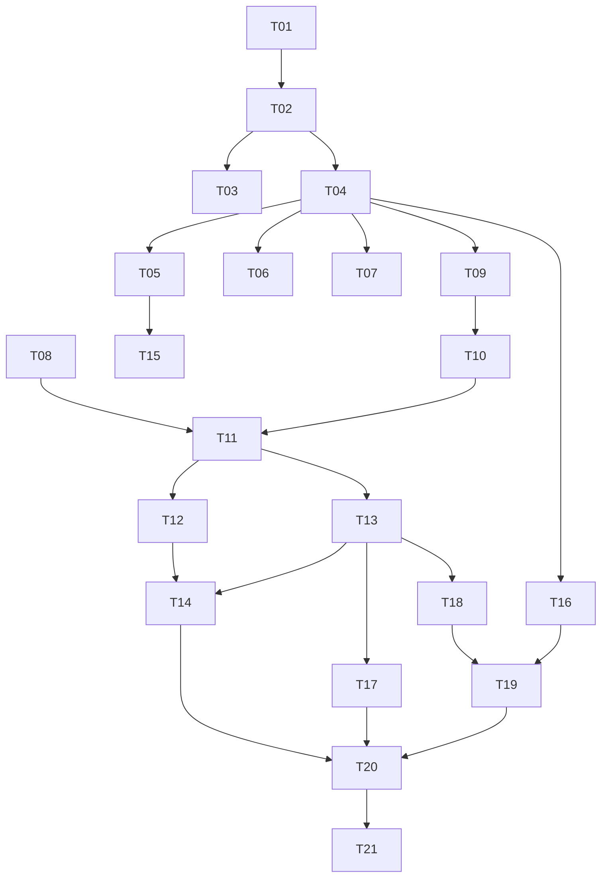

# PandaDays — Implementation Tasks

Each task is sized for one agent session. Read [SPEC.md](SPEC.md) and [../AGENTS.md](../AGENTS.md) first. Complete tasks in order unless marked parallelizable. Every task must end with `go vet ./...` and `go test ./...` passing.

Status legend: `[ ]` todo, `[x]` done.

---

## Phase 1 — Foundation

### [x] T01 Project skeleton
- `go.mod` (module `pandadays`), `cmd/panda/main.go` with subcommand dispatcher: `serve` (default), `version`; unknown → usage.
- `internal/config`: load env vars from SPEC §1.
- `internal/web`: server bootstrap, router, graceful shutdown, `GET /healthz`.
- Base layout template, mobile-first CSS skeleton, vendored htmx in `web/static`, all embedded via `embed`.
- Security headers middleware (SPEC §9), request logging (`log/slog`).
- **Done when**: `go run ./cmd/panda` serves `/healthz` → 200 and an empty styled page.

### [x] T02 Database & migrations
- `internal/db`: open SQLite (WAL, foreign keys, busy timeout), embedded migrations runner with `schema_migrations`.
- `0001_init.sql` with the full schema from SPEC §7 and default `settings` rows.
- Test helper to open an in-memory/temp DB.
- **Done when**: tests verify migrations apply idempotently and FK enforcement is on.

### [x] T03 i18n
- `internal/i18n`: load `locales/en.json`, `locales/zh.json`; `t` template func; language resolution (user → site → Accept-Language → en).
- Test: missing key in zh falls back to en; a test asserts both files have identical key sets.
- **Done when**: layout renders in both languages via `?lang=` override in dev or resolution logic in tests.

---

## Phase 2 — Auth

### [x] T04 Users, passwords, sessions
- `internal/auth`: bcrypt hashing, password policy 8–32 runes (and ≤72 bytes), random password generator (16 chars), session create/lookup/delete (hashed tokens), cookie handling (persistent vs session cookie, `session_days` setting, 12h non-persistent cap).
- Middleware: load current user; `RequireLogin`; `RequireAdmin`; forced-password-change redirect.
- CSRF middleware (per-session token, hidden field + `HX-Request` header support).
- Login rate limiting (in-memory backoff).
- Creating a user also creates the reserved Default collection and Default tag (shared helper `CreateUser` in a service package).
- **Done when**: unit tests cover policy, session expiry, CSRF reject, forced change redirect.
- Integration: `auth.Service.CreateUser` creates users and reserved defaults in one transaction; `Authenticate` applies IP+account backoff. HTTP guards use `web.CurrentUser` / `web.CurrentSession`.
- Forms use `{{template "csrf-field" .}}` with `pageData.CSRFToken`; the layout supplies `X-CSRF-Token` to htmx. Streaming multipart/JS requests must send that header. Signed anonymous CSRF cookies support the upcoming login/setup forms and expire on server restart. Health/static routes are exempt from CSRF and forced-password redirects; the placeholder home remains public until the auth pages are implemented in T05.

### [x] T05 Login / logout / change password pages
- `/login` (username or email, "Keep me signed in"), `/logout`, `/password`.
- Changing password clears `must_change_password` and deletes other sessions.
- Timezone auto-capture: after login, if user timezone empty, JS posts browser timezone to `/settings/timezone`.
- **Done when**: handler tests for login success/failure, inactive user rejected, forced-change flow.
- Integration: `GET /` now requires login. Handlers live in `internal/web/account.go`; `auth.Service.ChangePassword` (shares login backoff per user) and `SetTimezoneIfEmpty` / `ValidateTimezone` (reuse in T15 for explicit timezone changes). Pages build data via `newPageData(r)`, which exposes `.User` for the header nav and sets `CaptureTimezone` (loads `static/timezone.js`) only for logged-in users with no timezone who are not forced to change their password. Use `renderStatus` to render forms with validation errors.

### [ ] T06 Setup token flow
- On `serve` start: if no admin and no unexpired token → generate, store hash + expiry (1h), print token to stdout with clear banner.
- `/setup` GET/POST: validates token (constant-time compare of hashes), creates admin (via `CreateUser`), deletes token. 404 once an admin exists.
- **Done when**: tests for valid, expired, reused, and post-admin 404.

### [ ] T07 CLI `reset-admin-password`
- `panda reset-admin-password --username <name>`: opens DB, verifies user is admin, sets random password, `must_change_password=1`, deletes sessions, prints password.
- **Done when**: test invokes the command function against a temp DB.

---

## Phase 3 — Core Days

### [ ] T08 Date engine (pure functions)
- `internal/days/calc.go`: effective target (next occurrence for weekly/monthly/yearly with month-end and Feb 29 clamping), classification (future/today/past), list label, card breakdown (y/m/d/h/m), occurrence ordinal.
- All functions take `now time.Time` and `*time.Location` explicitly.
- **Done when**: table-driven tests incl. leap years, month-end, DST transitions, all-day vs timed, today edge.
- Parallelizable with T04–T07.

### [ ] T09 Collections & tags CRUD
- Repos + handlers + pages: list, create, rename, recolor, delete.
- Reserved Default cannot be renamed/deleted; names unique per user (case-insensitive); reserved name blocked.
- Delete collection → move days to Default (transaction). Delete tag → ensure orphaned days get Default tag.
- **Done when**: tests for reserved protection, move-to-default, cross-user access returns 404.

### [ ] T10 Days CRUD
- Repo + handlers + form: title, date, optional time, repeat (default none), collection (default Default), tags multi-select (default Default), comment, style (color, icon/emoji; bg chosen later in T13).
- Quota check `quota_days` on create.
- Validation and localized error messages.
- **Done when**: tests for defaults applied, validation, quota, ownership.

### [ ] T11 Home list & card view
- `/` list of active own days + (later) shared days; Future/Past toggle via htmx partial; ordering per SPEC §8.
- List item: title, date, label from date engine, state styling, collection/tag chips (own only).
- `/days/{id}` card view: big countdown, breakdown, comment, style applied, placeholder for attachments.
- CSS for visual states (future/past/archived/shared defaults + custom style override; badges always visible).
- **Done when**: handler tests for toggle filtering and ordering; manual check on 375px and 1280px widths.

---

## Phase 4 — Archive, Filters, Attachments

### [ ] T12 Archive & filter views
- Archive/unarchive actions; `/archive` page.
- Collection detail and tag detail include archived days (with "hide archived" toggle) and correct visual state.
- Home excludes archived.
- **Done when**: tests for visibility rules per page.
- Parallelizable with T13.

### [ ] T13 Attachments
- Upload endpoint (multipart streaming), kind detection by sniffing, storage under `/data/media/{user_id}/{uuid}`, `MaxBytesReader` sized to remaining per-card allowance.
- Enforce `max_card_bytes` and `quota_bytes` (user override or site default); maintain `used_bytes` in the same transaction.
- Serve `/attachments/{id}` with auth + safe headers + range support (SPEC §5).
- Delete attachment; deleting day removes files; bg style fallback.
- Card view gallery: image thumbs (lightbox optional), `<audio>`, `<video>`, file links; usage bars (card / user).
- Voice recording (MediaRecorder) JS on the day card/form.
- Choose background image from day's image attachments.
- **Done when**: tests for limit enforcement, unauthorized access 404, HTML/SVG served as download, used_bytes accuracy after delete.

---

## Phase 5 — Sharing

### [ ] T14 Sharing
- Create share for a day or collection with multiple recipients (username/email list), `show_comment` toggle; edit recipients; revoke.
- Generic error for unknown recipients; disallow self.
- Access resolver: `CanView(user, day)` → (allowed, showComment) considering direct and collection shares; dedupe.
- `/shared` page; shared days merged into Home with shared styling and "from @owner" badge; recipient hide/unhide.
- Shared card view: read-only, hides owner's collection/tags, comment per flag, attachments viewable.
- Deleting day/collection removes related shares.
- **Done when**: tests for multi-recipient access, revoke, comment visibility, collection-share liveness, archived days in shared collection hidden, no leakage of tags/collection.

---

## Phase 6 — Admin & Settings

### [ ] T15 User settings
- `/settings`: language, timezone (select from IANA list, validated), link to password change, usage summary.
- Parallelizable with T16.

### [ ] T16 Admin users & site settings
- `/admin/users`: list with usage; create user (random password shown once, forced change); reset password; activate/deactivate; delete (with confirmation, removes media); set per-user `quota_days`, `quota_bytes`, `max_card_bytes` (blank = site default).
- `/admin/settings`: `site_lang`, `session_days`, default quotas/limits, `backup_retention`.
- Admin cannot deactivate/delete themselves or the last admin.
- **Done when**: tests for RequireAdmin, last-admin protection, quota override resolution.

---

## Phase 7 — Data Portability & Backup

### [ ] T17 User export / import
- `internal/portability`: export zip (CSV + media) per SPEC §6.1 with formula-injection escaping and UTF-8 BOM.
- Import: upload → preview (counts, errors, quota check) → confirm; merge skipping duplicates; create missing collections/tags; transactional with temp files.
- Guards: zip-slip, symlinks, max entries, max uncompressed size, limits.
- **Done when**: round-trip test (export user A → import into user B → equal data & media), duplicate skip test, malicious zip test, CSV injection test.

### [ ] T18 Backup engine + CLI
- `internal/backup`: create (VACUUM INTO + media + manifest with SHA-256) streamed to a writer; validate archive; restore with atomic swap and rollback.
- CLI: `panda backup --out`, `panda restore --file`.
- **Done when**: tests for create→restore equality, checksum mismatch rejected, tar-slip rejected, simulated failure mid-swap rolls back.

### [ ] T19 Admin backup/restore Web UI
- `/admin/backup`: create & download, retained backups list (download/delete, retention pruning), restore upload with password re-entry.
- Maintenance mode middleware (localized 503, drain in-flight), DB handle swap/reopen, session wipe, redirect to login.
- **Done when**: integration test performing restore through HTTP; other requests receive 503 during restore.

---

## Phase 8 — Delivery

### [ ] T20 Docker & docs
- Multi-stage `Dockerfile` (CGO disabled, static binary, non-root user, `/data` volume, `HEALTHCHECK`), `compose.yaml` (service `pandadays`, volume, env vars, restart policy).
- `README.md`: install, first-run setup token (`docker compose logs pandadays`), reset admin password command, backup/restore, reverse proxy note (TLS, large body size for restore uploads), env vars.
- **Done when**: `docker compose up` → setup via token → create user → login works; `docker compose exec pandadays panda reset-admin-password --username admin` works.

### [ ] T21 Final polish & QA
- Accessibility pass (labels, contrast, focus, badges not color-only).
- zh translations complete.
- Manual QA matrix: iOS Safari, Android Chrome, desktop Chrome/Firefox; voice recording; large video upload; restore.

---

## Dependency Graph

