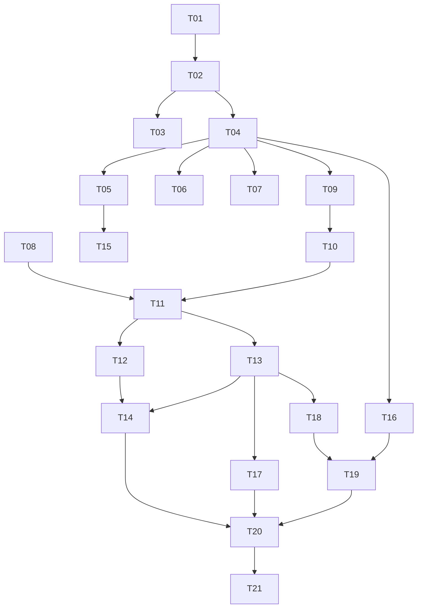

# PandaDays — Implementation Tasks

Each task is sized for one agent session. Read [SPEC.md](SPEC.md) and [../AGENTS.md](../AGENTS.md) first. Complete tasks in order unless marked parallelizable. Every task must end with `go vet ./...` and `go test ./...` passing.

Status legend: `[ ]` todo, `[x]` done.

---

## Phase 1 — Foundation

### [x] T01 Project skeleton
- `go.mod` (module `pandadays`), `cmd/panda/main.go` with subcommand dispatcher: `serve` (default), `version`; unknown → usage.
- `internal/config`: load env vars from SPEC §1.
- `internal/web`: server bootstrap, router, graceful shutdown, `GET /healthz`.
- Base layout template, mobile-first CSS skeleton, vendored htmx in `web/static`, all embedded via `embed`.
- Security headers middleware (SPEC §9), request logging (`log/slog`).
- **Done when**: `go run ./cmd/panda` serves `/healthz` → 200 and an empty styled page.

### [x] T02 Database & migrations
- `internal/db`: open SQLite (WAL, foreign keys, busy timeout), embedded migrations runner with `schema_migrations`.
- `0001_init.sql` with the full schema from SPEC §7 and default `settings` rows.
- Test helper to open an in-memory/temp DB.
- **Done when**: tests verify migrations apply idempotently and FK enforcement is on.

### [x] T03 i18n
- `internal/i18n`: load `locales/en.json`, `locales/zh.json`; `t` template func; language resolution (user → site → Accept-Language → en).
- Test: missing key in zh falls back to en; a test asserts both files have identical key sets.
- **Done when**: layout renders in both languages via `?lang=` override in dev or resolution logic in tests.

---

## Phase 2 — Auth

### [x] T04 Users, passwords, sessions
- `internal/auth`: bcrypt hashing, password policy 8–32 runes (and ≤72 bytes), random password generator (16 chars), session create/lookup/delete (hashed tokens), cookie handling (persistent vs session cookie, `session_days` setting, 12h non-persistent cap).
- Middleware: load current user; `RequireLogin`; `RequireAdmin`; forced-password-change redirect.
- CSRF middleware (per-session token, hidden field + `HX-Request` header support).
- Login rate limiting (in-memory backoff).
- Creating a user also creates the reserved Default collection and Default tag (shared helper `CreateUser` in a service package).
- **Done when**: unit tests cover policy, session expiry, CSRF reject, forced change redirect.
- Integration: `auth.Service.CreateUser` creates users and reserved defaults in one transaction; `Authenticate` applies IP+account backoff. HTTP guards use `web.CurrentUser` / `web.CurrentSession`.
- Forms use `{{template "csrf-field" .}}` with `pageData.CSRFToken`; the layout supplies `X-CSRF-Token` to htmx. Streaming multipart/JS requests must send that header. Signed anonymous CSRF cookies support the upcoming login/setup forms and expire on server restart. Health/static routes are exempt from CSRF and forced-password redirects; the placeholder home remains public until the auth pages are implemented in T05.

### [x] T05 Login / logout / change password pages
- `/login` (username or email, "Keep me signed in"), `/logout`, `/password`.
- Changing password clears `must_change_password` and deletes other sessions.
- Timezone auto-capture: after login, if user timezone empty, JS posts browser timezone to `/settings/timezone`.
- **Done when**: handler tests for login success/failure, inactive user rejected, forced-change flow.
- Integration: `GET /` now requires login. Handlers live in `internal/web/account.go`; `auth.Service.ChangePassword` (shares login backoff per user) and `SetTimezoneIfEmpty` / `ValidateTimezone` (reuse in T15 for explicit timezone changes). Pages build data via `newPageData(r)`, which exposes `.User` for the header nav and sets `CaptureTimezone` (loads `static/timezone.js`) only for logged-in users with no timezone who are not forced to change their password. Use `renderStatus` to render forms with validation errors.

### [x] T06 Setup token flow
- On `serve` start: if no admin and no unexpired token → generate, store hash + expiry (1h), print token to stdout with clear banner.
- `/setup` GET/POST: validates token (constant-time compare of hashes), creates admin (via `CreateUser`), deletes token. 404 once an admin exists.
- **Done when**: tests for valid, expired, reused, and post-admin 404.
- Integration: `auth.EnsureSetupToken` (called from `cmdServe` via `issueSetupToken`) and `auth.Service.CompleteSetup` (token check + admin insert + token delete in one transaction; failures share login backoff per IP). `CreateUser` now delegates to the internal `insertUser(tx, …)` so other flows can create users inside their own transaction. `Service.HasAdmin` gates `/setup`; `GET /login` redirects to `/setup` while no admin exists. Setup signs the new admin in.

### [x] T07 CLI `reset-admin-password`
- `panda reset-admin-password --username <name>`: opens DB, verifies user is admin, sets random password, `must_change_password=1`, deletes sessions, prints password.
- **Done when**: test invokes the command function against a temp DB.
- Integration: `auth.ResetAdminPassword(ctx, db, username, now)` (exact username match, case-insensitive; returns `ErrUserNotFound` / `ErrNotAdmin`; password update + session delete in one transaction). `cmdResetAdminPassword` in `cmd/panda` refuses to run if `<DATA_DIR>/pandadays.db` does not exist (never creates a fresh DB), prints the password to stdout only, and warns if the admin is deactivated. Reuse the same pattern for admin-initiated user resets in T16.

---

## Phase 3 — Core Days

### [x] T08 Date engine (pure functions)
- `internal/days/calc.go`: effective target (next occurrence for weekly/monthly/yearly with month-end and Feb 29 clamping), classification (future/today/past), list label, card breakdown (y/m/d/h/m), occurrence ordinal.
- All functions take `now time.Time` and `*time.Location` explicitly.
- **Done when**: table-driven tests incl. leap years, month-end, DST transitions, all-day vs timed, today edge.
- Parallelizable with T04–T07.
- Integration: `days.Calculate(Schedule{Date, Time, Repeat}, now, loc)` returns original/effective targets, classification, localized list-message key/args, calendar breakdown, repeat ordinal (original = 0), and optional time since original. Render labels via `bundle.T(lang, result.ListLabel.Key, result.ListLabel.Args...)`. Empty time means all-day; empty repeat means none; invalid inputs return `ErrInvalidSchedule`. See SPEC §3.4 for recurrence, rounding, and DST conventions. No persistence or authorization surface is introduced.

### [x] T09 Collections & tags CRUD
- Repos + handlers + pages: list, create, rename, recolor, delete.
- Reserved Default cannot be renamed/deleted; names unique per user (case-insensitive); reserved name blocked.
- Delete collection → move days to Default (transaction). Delete tag → ensure orphaned days get Default tag.
- **Done when**: tests for reserved protection, move-to-default, cross-user access returns 404.
- Integration: `days.Groups` (`days.NewCollections` / `days.NewTags`, held as `Server.collections` / `Server.tags`) is one owner-scoped repo for both kinds: `List`, `Get` (→ `days.ErrNotFound` for missing or foreign rows), `Create`, `Update` (reserved may only be recolored), `Delete`, `DefaultID` (use for T10 form defaults). Names are trimmed, 1–100 runes, unique per owner with Unicode case folding; "Default"/"默认" are blocked. Colors are `#rrggbb` or empty (NULL). Collection delete also removes shares targeting it (T14). Routes: `GET/POST /collections`, `GET /collections/{id}`, `POST /collections/{id}/edit`, `POST /collections/{id}/delete` (same under `/tags`); `{id}` detail is where T12 adds the day list. Shared templates `groups.html` / `group.html`; layout defines `group-name` (localized reserved name), `swatch` (SVG `fill`, since CSP forbids inline styles), and `group-color-fields`. Delete uses `hx-confirm`; handlers answer htmx with `HX-Redirect` via `authRedirect`.

### [x] T10 Days CRUD
- Repo + handlers + form: title, date, optional time, repeat (default none), collection (default Default), tags multi-select (default Default), comment, style (color, icon/emoji; bg chosen later in T13).
- Quota check `quota_days` on create.
- Validation and localized error messages.
- **Done when**: tests for defaults applied, validation, quota, ownership.
- Integration: `days.Days` (`days.NewDays`, held as `Server.days`) is owner-scoped: `Get` (→ `days.ErrNotFound` for missing/foreign rows; includes sorted `TagIDs`), `Create` (enforces quota inside the transaction → `ErrQuotaDays`), `Update` (leaves `archived_at` and `style_bg_attachment_id` untouched), `Delete` (also removes shares targeting the day; attachment files are T13's job), `QuotaDays` (user `quota_days` override, else `default_quota_days`; reuse in T16/T17). `NormalizeDayInput` holds the DB-free rules (title 1–200 runes, strict `YYYY-MM-DD`/`HH:MM`, repeat, comment ≤10,000 runes, `#rrggbb` color, icon ≤16 runes without spaces) — reuse for T17 import. `CollectionID` 0 / empty `TagIDs` select the reserved defaults; foreign or malformed group IDs fail with `ErrCollectionInvalid` / `ErrTagInvalid` (422, no existence leak). `Day.Schedule()` feeds `days.Calculate`. Routes: `GET /days/new`, `POST /days`, `GET /days/{id}` (minimal detail page `day.html` — T11 replaces it with the card view), `GET/POST /days/{id}/edit`, `POST /days/{id}/delete` (`hx-confirm`, redirects to `/`). Form template `day_form.html` serves both create and edit; layout defines `day-delete`. `userLocation(user)` in `internal/web/days.go` resolves the user's timezone (fallback `time.Local`) for T11. Home currently only links to "New day".

### [x] T11 Home list & card view
- `/` list of active own days + (later) shared days; Future/Past toggle via htmx partial; ordering per SPEC §8.
- List item: title, date, label from date engine, state styling, collection/tag chips (own only).
- `/days/{id}` card view: big countdown, breakdown, comment, style applied, placeholder for attachments.
- CSS for visual states (future/past/archived/shared defaults + custom style override; badges always visible).
- **Done when**: handler tests for toggle filtering and ordering; manual check on 375px and 1280px widths.
- Integration: `Days.ListActive(owner)` returns non-archived own days with `TagIDs`; pure `days.HomeList(list, when, now, loc)` calculates, keeps Future (incl. Today and all repeating days) or Past, and orders Future ascending / Past descending by effective target (ties: title, ID); `days.ParseWhen` defaults to future. `Server.now` is the injectable clock (use it instead of `time.Now()` in handlers). `GET /` renders `home.html`; htmx requests (except `HX-History-Restore-Request`) get only the `home-days` partial via `renderPartial` (`Vary: HX-Request`). Reusable list pieces live in `layout.html`: `day-item` (takes `dayItem` from `internal/web/home.go`; `Collection`/`Tags` nil for shared days), `day-accent` (custom color as SVG `fill`, CSS `--state` default), `day-icon` (⏳/✓/📦 defaults), `day-badges` (add the "from @owner" badge here in T14; `.day-shared`/`.badge-shared` CSS exists), `day-when`. `loadGroupIndex`/`dayTags` resolve chips. Card view (`day.html`) uses `countdown`, `breakdownParts`, `ordinalNumber`; the `#attachments` section is the T13 placeholder.

---

## Phase 4 — Archive, Filters, Attachments

### [x] T12 Archive & filter views
- Archive/unarchive actions; `/archive` page.
- Collection detail and tag detail include archived days (with "hide archived" toggle) and correct visual state.
- Home excludes archived.
- **Done when**: tests for visibility rules per page.
- Parallelizable with T13.
- Integration: `Days.SetArchived(ctx, owner, id, archived, now)` updates only archive state and `updated_at`; repeated archive requests preserve the original timestamp, and missing/foreign days return `ErrNotFound`. `ListArchived`, `ListCollection`, and `ListTag` return owner-scoped days with tags; group lists include archived by default and take `hideArchived` (missing/foreign groups return `ErrNotFound`). `POST /days/{id}/archive` and `/unarchive` are CSRF-protected owner actions on the card, redirecting back to it (including `HX-Redirect`). `/archive` is linked in the navigation. Collection/tag details toggle `?hide_archived=1` via the `group-days` htmx partial, with full-page history restoration and non-JS links. Archive/group lists keep both date halves: upcoming ascending, then past descending, reusing Home's date labels, chips, styles, and always-visible archive badges.

### [x] T13 Attachments
- Upload endpoint (multipart streaming), kind detection by sniffing, storage under `/data/media/{user_id}/{uuid}`, `MaxBytesReader` sized to remaining per-card allowance.
- Enforce `max_card_bytes` and `quota_bytes` (user override or site default); maintain `used_bytes` in the same transaction.
- Serve `/attachments/{id}` with auth + safe headers + range support (SPEC §5).
- Delete attachment; deleting day removes files; bg style fallback.
- Card view gallery: image thumbs (lightbox optional), `<audio>`, `<video>`, file links; usage bars (card / user).
- Voice recording (MediaRecorder) JS on the day card/form.
- Choose background image from day's image attachments.
- **Done when**: tests for limit enforcement, unauthorized access 404, HTML/SVG served as download, used_bytes accuracy after delete.

---

## Phase 5 — Sharing

### [x] T14 Sharing
- Create share for a day or collection with multiple recipients (username/email list), `show_comment` toggle; edit recipients; revoke.
- Generic error for unknown recipients; disallow self.
- Access resolver: `CanView(user, day)` → (allowed, showComment) considering direct and collection shares; dedupe.
- `/shared` page; shared days merged into Home with shared styling and "from @owner" badge; recipient hide/unhide.
- Shared card view: read-only, hides owner's collection/tags, comment per flag, attachments viewable.
- Deleting day/collection removes related shares.
- **Done when**: tests for multi-recipient access, revoke, comment visibility, collection-share liveness, archived days in shared collection hidden, no leakage of tags/collection.

---

## Phase 6 — Admin & Settings

### [x] T15 User settings
- `/settings`: language, timezone (select from IANA list, validated), link to password change, usage summary.
- Parallelizable with T16.

### [x] T16 Admin users & site settings
- `/admin/users`: list with usage; create user (random password shown once, forced change); reset password; activate/deactivate; delete (with confirmation, removes media); set per-user `quota_days`, `quota_bytes`, `max_card_bytes` (blank = site default).
- `/admin/settings`: `site_lang`, `session_days`, default quotas/limits, `backup_retention`.
- Admin cannot deactivate/delete themselves or the last admin.
- **Done when**: tests for RequireAdmin, last-admin protection, quota override resolution.

---

## Phase 7 — Data Portability & Backup

### [x] T17 User export / import
- `internal/portability`: export zip (CSV + media) per SPEC §6.1 with formula-injection escaping and UTF-8 BOM.
- Import: upload → preview (counts, errors, quota check) → confirm; merge skipping duplicates; create missing collections/tags; transactional with temp files.
- Guards: zip-slip, symlinks, max entries, max uncompressed size, limits.
- **Done when**: round-trip test (export user A → import into user B → equal data & media), duplicate skip test, malicious zip test, CSV injection test.
- Integration: `portability.Service` (`portability.New(db, <data>/media, <data>/tmp)`, held as `Server.portability`) is owner-scoped: `Export(ctx, owner, now, w)` streams the zip (`days.csv` with BOM/CRLF, cells starting with `= + - @ \t \r` prefixed by `'`, lists `|`-separated with `\` escaping, collection/tag names exported verbatim with reserved = "Default", `archived` RFC 3339 UTC, `style_bg` = media path; media as `media/<uuid>_<filename>`); `ExportFilename(username, date)`. Import is two-step: `Stage(owner, r, limit, now)` copies the upload to `<data>/tmp/import-<owner>-<token>` (TTL `StagedTTL` = 1h, stale files swept; `UploadLimit` = remaining byte quota + CSV cap), `Preview`/`Import(ctx, owner, token, now)` re-validate the archive (zip or bare CSV; rejects traversal, absolute/backslash/colon names, symlinks, non-regular and duplicate entries, too many entries, oversize declared sizes → `ErrUnsafeArchive`/`ErrTooManyEntries`/`ErrArchiveTooLarge`). Rows reuse `days.NormalizeDayInput`; duplicates = exact title + date + collection (case-insensitive name), also within the file; per-row problems are `RowError`s, quotas → `ErrQuota`. `Import` extracts media to `.import-*` temp files, then inserts groups/days/tags/attachments and bumps `used_bytes` in one transaction, renaming files only before commit. Routes: `GET /settings/export`, `POST /settings/import` (multipart; CSRF middleware now parses this form like attachment uploads, so the plain form's `csrf_token` field works), `POST /settings/import/confirm` (`import.html` renders preview and result). New helpers: `media.Sniff`/`SafeFilename`/`NewUUID`, `days.IsReservedName`/`ValidateGroupName`. T18/T19 can reuse the archive-guard approach and the `<data>/tmp` staging directory.

### [x] T18 Backup engine + CLI
- `internal/backup`: create (VACUUM INTO + media + manifest with SHA-256) streamed to a writer; validate archive; restore with atomic swap and rollback.
- CLI: `panda backup --out`, `panda restore --file`.
- **Done when**: tests for create→restore equality, checksum mismatch rejected, tar-slip rejected, simulated failure mid-swap rolls back.
- Integration: `backup.New(dataDir, appVersion)` exposes `Create(ctx, database, writer, now)`, `Validate(ctx, reader)` (returns `Manifest`), and `Restore(ctx, reader, now)`. Pause writes during create; close all DB handles and stop filesystem access before restore. Restore stages in `<data>/tmp`, validates checksums/schema/SQLite integrity, retains a pre-restore archive, swaps DB/media with rollback, migrates, and clears sessions. CLI commands are offline and require the server stopped; T19 must supply maintenance/draining and reopen its own handles afterward. See SPEC §6.3 for archive limits and recovery behavior.

### [x] T19 Admin backup/restore Web UI
- `/admin/backup`: create & download, retained backups list (download/delete, retention pruning), restore upload with password re-entry.
- Maintenance mode middleware (localized 503, drain in-flight), DB handle swap/reopen, session wipe, redirect to login.
- **Done when**: integration test performing restore through HTTP; other requests receive 503 during restore.
- Integration: `/admin/backup` supports create/download with optional retention, retained download and confirmed deletion, and streamed restore uploads with password re-entry. The request gate drains all admitted requests before closing DB handles; replacement services/routes are published before normal traffic resumes. Recovery snapshots are excluded from ordinary retention pruning and require explicit deletion. Failed rollback/reopen leaves maintenance enabled with recovery details in the server log. Web server owners must call `Server.Close` after serving to close the current (possibly replaced) handle.

---

## Phase 8 — Delivery

### [x] T20 Docker & docs
- Multi-stage `Dockerfile` (CGO disabled, static binary, non-root user, `/data` volume, `HEALTHCHECK`), `compose.yaml` (service `pandadays`, volume, env vars, restart policy).
- `README.md`: install, first-run setup token (`docker compose logs pandadays`), reset admin password command, backup/restore, reverse proxy note (TLS, large body size for restore uploads), env vars.
- **Done when**: `docker compose up` → setup via token → create user → login works; `docker compose exec pandadays panda reset-admin-password --username admin` works.
- Integration: multi-stage CGO-free image runs as UID/GID 10001 with `/data` as its only persistent volume and `/healthz` health checks (also declared in `compose.yaml`, since Podman's OCI-format builds drop the image `HEALTHCHECK`). Compose defaults to localhost HTTP; set `PANDA_BASE_URL` and `PANDA_COOKIE_SECURE=true` behind TLS. README covers setup, account recovery, environment variables, storage, updates, reverse proxy limits, and online/offline backup/restore. Validated with Docker Compose v2.40 against Podman 5.8 via a scripted run: `up --build` → healthy, UID 10001, static binary → setup token from `docker compose logs` → setup → create user → both logins → `docker compose exec pandadays panda reset-admin-password --username admin` (old password rejected, new accepted) → restart persistence → offline CLI backup, `down -v`, fresh-volume restore, restored logins.
- Deployment follow-up: Compose runs only a prebuilt local `localhost/pandadays:latest` with `pull_policy: never`. README documents laptop builds targeting the server architecture, image save/transfer/load, server updates, and fresh-host restore without compiling on the server.
- Automatic image identity: `scripts/build.ps1` uses UTC committer-datetime plus a fixed 12-character SHA, rejects dirty trees unless explicitly marked `.dirty`, embeds the generated version, and builds/saves both the version tag and `latest` without manual tags.
- [x] Deployment simplification: unprefixed runtime/build environment variables; self-contained Compose with fixed container port 8080, `/data`, host `./data` bind mount, and `localhost/pandadays:latest`; remove `.env.example`. Browser language/timezone defaults, with validated preferences saved atomically during setup and editable later in Settings. Verified full Go tests/vet, build-script tests, Compose config, image build, non-root bind-mount writes, health checks, setup at 375px/1280px, and preference persistence after a container restart.
- [x] Reverse-proxy deployment defaults: inherit fixed address/data directory from the image, expose 8080 without publishing a host port, clarify Docker/OCI health checks and proxy networking, and keep README independent of other repositories. Verified rendered Compose configuration has no published ports or address/data environment overrides, retains the `/data` bind mount, and uses HTTPS defaults; checked image defaults and documentation consistency.

### [x] T21 Final polish & QA
- Accessibility pass (labels, contrast, focus, badges not color-only).
- [x] Unsaved day forms: browser-native confirmation before leaving create/edit forms with changed fields, protection after validation errors, and normal saves without prompting. Verified Go tests/vet, eight dependency-free JavaScript regressions, and Chromium navigation/cancel/confirm/reload/save flows at 375px/1280px.
- zh translations complete.
- Manual QA matrix: iOS Safari, Android Chrome, desktop Chrome/Firefox; voice recording; large video upload; restore.
- [x] Responsive laptop width: remove the main container's 960 px cap while preserving mobile/desktop padding and centered 420 px auth cards. Verified in Chromium at 375, 768, 1280, and 1600 px on setup, populated home/day, day edit, settings, admin users, and password pages; no horizontal document overflow. Full Go tests and vet pass.
- Integration: QA matrix and a11y checklist live in [QA.md](QA.md). Uploads are sniffed over the first 64 KiB (`media.Sniff`) so MediaRecorder WebM/MP4/Ogg voice notes are stored as audio. `web/static/app.js` shows localized htmx error/network messages in `#flash` and upload progress. Templates must reference static files via `{{asset "name"}}` (content-hashed `?v=`), and every `t "key"` must exist in all locales (enforced by `internal/web/polish_test.go`). Generic 400/500 responses are localized via `authError`. Header is sticky only at ≥768px. iPhone `.mov` uploads (`ftyp qt  `) are sniffed as `video/quicktime` and play inline. Screen-reader text: home has a visually hidden `h1`; day-list collection/tag chips carry a hidden field prefix (`a11y_list_test.go`). Every matrix row passed on 2026-10-18 via a Playwright harness. The harness used WebKit with iPhone emulation, Chromium with Pixel emulation, desktop Chromium and desktop Firefox, together with axe-core and accessibility-tree audits. On WebKit, AAC/H.264 playback could not be verified because that WebKit build has no codecs. Before each release, re-check recording and playback, and do a VoiceOver/TalkBack walkthrough, on real iOS/Android devices (see QA.md).

---

### [x] T22 Site-only administration
- Admin-only navigation and landing page; personal-content routes unavailable to admins without deleting existing data.
- Searchable users list, separate create/manage pages, avatar/username menu with Profile and Sign out, personal password change in Profile.
- Backup list with create/upload-restore buttons and per-entry download/restore/delete menu; password re-entry for every restore.
- Storage quotas and usage in M with exact byte conversion; inherited and zero limits preserved.
- **Done when**: authorization, search, creation, quota conversion, retained/upload restore, localization, and responsive UI verified; full Go tests and vet pass.
- Verified: full `go test ./...` and `go vet ./...`; CGO-free build; browser checks across nine screens in English/Chinese at 375px and 1280px without horizontal overflow. Exercised user creation/search, backup creation/download/deletion/retained restore, restored login, recovery snapshot, profile menu, and sign out on isolated data.

### [x] T23 Profile and user-management controls
- Header light/dark and Chinese/English icon toggles; saved theme/language preferences.
- Profile identity, timezone, optional avatar, masked password with right-aligned reset; no language dropdown or settings subtitle.
- Shared magnifier search field, Enter submission, adjacent create icon; creation/editing of display names, avatars, and comments.
- Compact clickable user rows and shared three-dot action menus; complete account detail with quotas and icon-only back navigation.
- New profile migration, bounded validated avatar uploads, identity/authorization tests, bilingual strings, and mobile/desktop checks.
- **Done when**: requested flows work at 375px/1280px; full tests, vet, and CGO-free build pass.
- Verified: full `go test ./...`, `go vet ./...`, CGO-free build, and JavaScript syntax checks pass. Chromium checks at 375px/1280px covered light/dark persistence, saved English/Chinese switching with search preserved, Enter search, create/edit/detail flows, enable/disable, temporary password reset, avatar upload/display, and cancel/confirm deletion without horizontal overflow.

### [x] T24 Tag editor and style pickers
- Multiline tag editor with `#`-triggered suggestions for existing owned tags, keyboard/click selection, and removable chips without the trigger prefix.
- 84 icon presets, custom icon entry, and default-icon reset.
- Shared day/collection/tag palette with 20 preset colors followed by a rainbow native custom-color picker; preserve no-color behavior and saved custom values.
- English/Chinese labels, mobile-first styling, JavaScript-free fallbacks, and existing unsaved-change protection retained.
- Verified: full Go tests and vet, CGO-free build, 14 dependency-free JavaScript tests, and Chromium checks at 375px/1280px in light/dark themes. Exercised create/edit persistence, custom colors/icons, Chinese/multiword matching, validation retention, literal markup, no-JavaScript controls, and exit-confirmation/cancel behavior for each picker.

### [x] T25 Coordinated pickers and notebook groups
- Match the icon grid width to the color palette and other day-form controls.
- Select or create tags with `#`; persist new tags atomically with the day and retain draft selections on errors.
- Show compact tag-shaped links with day counts and notebook-style collection cards with color, comment, and day count.
- Use `+` creation dialogs on both group pages, with validation retention, keyboard dismissal, and no-JavaScript fallbacks.
- **Done when**: business-rule and ownership tests, full Go tests/vet, JavaScript tests, and 375px/1280px browser checks pass.
- Verified: full `go test ./...`, `go vet ./...`, CGO-free build, and all 16 dependency-free JavaScript tests pass. Chromium checks confirmed identical icon/color field widths (294px at 375px and 1167px at 1280px), no document overflow, compact counted tags, notebook membership/counts, comment create/edit persistence, modal create/error/cancel/Escape flows, draft tag retention/removal/reselection, and no-JavaScript creation. English/Chinese and light/dark layouts checked.

### [x] T26 Share invitation inbox
- Profile-avatar pending count and Messages queue with 20-item cursor pagination and Load more.
- Per-recipient accept/reject, including accepting a previously rejected invitation.
- Pending/rejected invitations grant no day, comment, or attachment access; existing shares remain accepted at upgrade.
- Preserve retained recipients' decisions when editing shares; new recipients start pending.
- **Done when**: business-rule, authorization, pagination, migration compatibility, full Go tests/vet, and 375px/1280px UI checks pass.
- Verified: full Go tests/vet; Chromium checks at 375px/1280px, 20-to-23-item Load more without duplicates, badge update, reject then accept, and shared detail access.

### [x] T27 Header day search
- Borderless magnifier immediately left of the theme toggle expands into an inline search field in the same header row, with a magnifier submit button on the right (no dropdown below); theme and language icons are borderless too.
- Match active owned and accepted, visible shared day titles and authorized comments case-insensitively across future/past.
- Preserve authorization, shared-day deduplication, and normal Home date tabs when not searching.
- Localized search results, empty state, and clear-search link.
- Header refinement verified: title/comment search and comment-visibility tests; Chromium at 375px/1280px checks borderless icons/field, collapsed search, input focus, Enter submission, Escape/outside dismissal, and English/dark plus Chinese/light layouts without overflow.
- Inline expansion verified at 375px/1280px: the field and theme toggle share the same row, header height and theme-toggle position remain unchanged, and there is no horizontal overflow; focus and Escape/outside dismissal preserved.
- **Done when**: targeted search/authorization tests, full Go tests/vet, and 375px/1280px browser checks pass.
- Verified: full Go tests/vet and CGO-free build; Chromium checks in light/dark at 375px/1280px without horizontal overflow, mixed-case future/past search, Chinese search, empty state, and clear search. Messages localization and JavaScript-disabled pagination also checked.

### [x] T28 Calendar-style day detail
- Omit the automatic Default tag and explanatory help from the day tag editor.
- Use minute-precision HH:MM for sub-day list countdowns and timed detail breakdowns.
- Calendar card with icon/title, prominent date, countdown/elapsed time, compact non-default metadata, and owner action menu.
- Keep comments, expandable attachments, sharing controls, confirmation, and shared read-only authorization intact.
- **Done when**: targeted rendering/authorization tests, JavaScript tests, full Go tests/vet, and 375px/1280px UI checks pass.
- Verified: full Go tests/vet and all 18 JavaScript tests pass; CGO-free server and 375px/1280px browser checks confirm minute-precision clocks, icon/title alignment, larger date, hidden defaults/help, custom metadata, unclipped action menu, section expansion, archive/unarchive, and canceled deletion. English/light and Chinese/dark layouts have no horizontal overflow.

### [x] T29 Square calendar and menu-only controls
- Center a responsive square day card; allow long content to grow without clipping.
- Style all action menu entries consistently, retaining the Delete danger color.
- Remove duplicate owner attachment/sharing toggles; show those controls only through their menu links, including without JavaScript.
- Preserve shared recipients' read-only attachment access.
- **Done when**: rendering/authorization tests, JavaScript tests, full Go tests/vet, and 375px/1280px browser checks pass.
- Verified: full Go tests/vet and all 18 JavaScript tests pass. Browser checks measure 343x343 and 512x512 cards at 375px/1280px, confirm hidden-by-default owner controls, consistent menu styling, menu-only section switching with scripts enabled/blocked, and long-content growth without clipping or horizontal overflow.

### [x] T30 Day metadata, action dialogs, and creation attachments
- Hide reserved Default collection/tag badges in every day list, including default-only entries.
- Open Share and Attachment menu controls in accessible modal dialogs, retaining no-JavaScript overlays and redirect reopening.
- Add optional multiple-file uploads to day creation with quota checks, CSRF/ownership validation, explicit failure handling, and unsaved-file protection.
- **Done when**: targeted tests, full Go tests/vet, JavaScript tests, and 375px/1280px browser checks pass.
- Verified: full Go tests/vet and all 20 JavaScript tests pass. Browser checks at 375px/1280px confirm hidden default-only badges, modal Share/Attachment controls, Close/Escape, no-JavaScript fixed overlays, multi-file creation, and refreshed attachment lists after upload with dialog reopening. English/light and Chinese/dark dialogs have no horizontal overflow.

### [x] T31 Compact group detail actions
- Keep tag and collection detail pages focused on their day lists.
- Place icon-only archive, edit, and delete actions beside the group name, plus collection sharing.
- Open management forms in accessible dialogs with Cancel/Escape and no-JavaScript fallbacks; retain reserved-group protection and edit validation.
- **Done when**: group rendering/authorization tests, full Go tests/vet, and 375px/1280px browser checks pass.
- Verified: Go tests/vet and JavaScript tests pass. Browser checks at 375px/1280px confirm icon-only actions, modal Edit/Delete/Share dialogs without overflow, Escape/Cancel, archive filtering after htmx swaps, successful rename/delete, and link-based dialogs with scripts blocked.

### [x] T32 Separate Profile and Settings
- Avatar menu offers Profile (`/profile`) and Settings (`/settings`).
- Profile shows only identity: a square avatar container with a circular photo (click to choose a file, X to remove) beside fixed username, display name, and email rows; password reset link.
- Usernames stay unique and cannot be changed after creation; changing one's own email requires the current password (rate limited like password changes).
- Settings holds timezone, storage usage, and backup & restore (export/import); admins see timezone only.
- **Done when**: identity/re-authentication/avatar tests, full Go tests/vet, and 375px/1280px browser checks pass.
- Verified: full Go tests/vet and CGO-free build. Chromium checks at 375px/1280px (English/light, Chinese/dark) confirm avatar picker preview, X removal, fixed username, password prompt appearing only after an email edit, wrong-password rejection with retained input, successful email change, the Profile/Settings menu, and no horizontal overflow.

### [x] T33 Media library and attachment picker
- Header **Media** link (`/media`, users only) lists every attachment the user uploaded across their days, newest first, with previews, size, upload time, source-day link, and delete (returning to the library).
- On the new-day form, **Add attachments** opens a modal dialog with **Media library** and **Upload file** tabs (keyboard arrow/Home/End navigation, Done/Escape). A status line summarizes library picks and new files. Without JavaScript both sections render inline.
- Picked library items are copied into independent attachments of the new day, counting toward the per-day and account quotas together with uploads. Foreign or unknown IDs return 404 without creating a day; picks survive validation and quota errors.
- **Done when**: library scoping/authorization/copy/quota tests, full Go tests/vet, JavaScript tests, and 375px/1280px browser checks pass.
- Verified: full Go tests/vet and all 20 JavaScript tests pass. Chromium checks at 375px/1280px confirm the header link, library grid, tabbed picker dialog, selection status, Escape/Done, and creating a day with two library copies plus one upload.

### [x] T34 Unified media tabs and focused previews
- Share Media library / Upload file / Voice recording tabs between new-day creation and the card's attachment manager; recordings are previewed and submitted with the selected files.
- Keep only Save below edit fields; retain attachment and delete actions in the card menu.
- Clear image backgrounds without removing the image attachment, with owner-scoped authorization.
- Keep the media library grid compact; show details, source, original link, and deletion only in the item preview, beside the media on desktop and below on mobile.
- **Done when**: ownership, combined quota, background-preservation and UI tests pass; full Go tests/vet and browser checks at 375px/1280px pass.
- Verified: full Go tests/vet and all 26 JavaScript tests pass. Browser checks at 375px/1280px cover tab layout and keyboard navigation, Save-only edit forms, compact media grids and responsive preview details, background removal preserving attachments, and creation with a library copy, upload, and mocked microphone recording. Existing-day library copies also save through the tabbed manager.

### [x] T35 Streamlined navigation and Sharing overview
- Move Archive and Sharing into the avatar dropdown; add Home to the regular-user header and remove the redundant Home link on owned day details.
- Sharing has Shared to Others (owner-scoped, deduplicated day/collection targets with share-setting links) and Shared to Me (existing accepted/hidden shared days) tabs.
- Media details omit the repeated Media page heading while keeping the filename and controls.
- **Done when**: outgoing target lifecycle/authorization, localized menu/tab/detail tests, full Go tests/vet, and 375px/1280px browser checks pass.
- Verified: full Go tests/vet pass; Chromium checks at 375px/1280px confirm the avatar menu, sharing tabs and target links, Home-only header navigation, and responsive media details without the repeated heading. English and Chinese layouts have no horizontal overflow.

### [x] T36 Preserve removed attachments and guard empty uploads
- Separate removal from a Day from permanent media-library deletion; retain files for reuse, account usage, and source-day details while clearing card usage, backgrounds, and recipient access.
- Disable existing-day Upload until library media, a local file, or a completed recording is selected; keep new-day attachments optional.
- **Done when**: removal/reuse/authorization/storage and selection-state regression tests pass, full Go tests/vet and JavaScript tests pass, and attachment controls are checked at 375px/1280px.
- Verified: full Go tests/vet and all 32 JavaScript tests pass. Migration preserves existing attachments, backgrounds, and account usage; export/import does not reattach removed media. Browser checks at 375px/1280px confirm no overflow, disabled empty Upload, selection/clearing for library/files/recordings, and removal preserving library details and file downloads.

### [x] T37 Voice recording feedback and card playback
- Show a live microphone-level bar and elapsed timer in both recording pickers.
- Keep stopped recordings playable before saving/uploading and uploaded audio playable beneath the day card comment.
- Preserve attachment authorization, shared-comment visibility, and removed-media behavior.
- **Done when**: recording lifecycle and card playback/authorization tests, full Go tests/vet, JavaScript tests, and 375px/1280px browser checks pass.
- Verified: full Go tests/vet and all 37 JavaScript tests pass. Chromium checks with synthesized microphone audio at 375px/1280px verify changing input levels, elapsed time, playable previews before upload in both pickers, and playable uploaded recordings beneath the comment. English and Chinese controls have no horizontal overflow. CSP permits local recording previews without broadening other resource sources.

### [x] T38 Isolated test storage and actionable named audio players
- Isolate web test media, backup, and temporary files from default runtime data, including user-deletion tests.
- Use named audio-player panels on cards, attachment managers, recording previews, and media details.
- Show authorized, localized missing-file and permission diagnostics for original-file access, library copies, and playback; preserve 404s for unauthorized viewers.
- Allow repeated copies of available library media and reject missing library files before creating a day.
- **Done when**: storage-isolation, playback-error, authorization, and repeat-copy regressions, full Go tests/vet, JavaScript tests, and 375px/1280px browser checks pass.
- Verified: full Go tests/vet and all 44 JavaScript tests pass. The runtime media file list, sizes, and timestamps remained unchanged during full validation. Chromium checks at 375px/1280px cover named local previews, playable card/library audio and original-file ranges, repeated library copies, and localized inline missing-file diagnostics without overflow. The Windows executable was rebuilt.

### [x] T39 Compact attachment manager and renaming
- Collapse the three add-source tabs behind an Add button; show only this day's used space.
- Show capped filenames, readable sizes, on-demand audio playback, and trailing rename/remove controls.
- Allow editing stopped recording names and owner-scoped renaming of every uploaded attachment type, including retained library files.
- Preserve removal-to-library semantics, stored content, quotas, and shared read-only access.
- **Done when**: rename/authorization and recording/playback regressions, full Go tests/vet, JavaScript tests, and 375px/1280px browser checks pass.
- Verified: full Go tests/vet and all 47 JavaScript tests pass. Isolated Chromium checks in English and Chinese at 375px/1280px confirm collapsed Add tabs, single-line attachment rows, full-width content without overflow, capped names, and on-demand playback. Renaming stopped recordings persists through upload; uploaded files and removed library items remain renameable without changing their contents or storage usage.

### [x] T40 Consistent compact recording rows and bare expanded players
- Show recording filename, size, and Play/rename/remove controls beneath the card comment, matching attachment-manager rows.
- Reveal only the player below the row on Play, without repeating the filename or adding a nested bordered panel.
- Preserve inline playback diagnostics, distinct player IDs, and read-only sharing.
- **Done when**: card/manager markup and authorization regressions, Go tests/vet, JavaScript tests, and 375px/1280px browser checks pass.
- Verified: full Go tests/vet and all 47 JavaScript tests pass. Isolated Chromium checks at 375px/1280px in English and Chinese confirm single-line filename/size/action rows, independently revealed playable controls, no repeated captions or nested player borders, distinct card/manager IDs, and no horizontal overflow.

### [x] T41 Collapsible all-attachment cards and dismissible playback
- Show a separator and collapsed attachment list below the comment only when attachments exist, including images, video, audio, and other files.
- Remove individual attachment-item borders and preserve owner actions and shared read-only access.
- Pause/collapse audio on switching attachments, outside clicks, closing its list/dialog, and Escape; keep native player interactions usable.
- **Done when**: attachment-type/authorization and playback-dismissal regressions, full Go tests/vet, JavaScript tests, and 375px/1280px browser checks pass.
- Verified: full Go tests/vet and all 55 JavaScript tests pass. Isolated Chromium checks at 375px/1280px cover collapsed lists, separators, borderless mixed attachment rows, loaded images, switching recordings, outside-click dismissal, native controls, and list/dialog closure without overflow. Owner and shared attachment-type/access regressions pass in English and Chinese.

### [x] T42 Media upload timeline and type filters
- Group the media library by upload day or month in the user's timezone, newest first.
- Filter all media, images, videos, voice/audio, and generic files using URL-backed controls.
- Keep compact previews and owner-only access; distinguish an empty filter from an empty library.
- **Done when**: timezone/grouping/filter/authorization regressions, Go tests/vet, and 375px/1280px browser checks pass.
- Verified: full Go tests/vet and all 55 JavaScript tests pass. Isolated Chromium checks cover 40 combinations of day/month grouping, all five type filters, English/Chinese, and 375px/1280px layouts without overflow. Image/video previews load, video details remain playable, and filter submissions also work without JavaScript.

### [x] T43 Content-addressed media and duplicate upload rejection
- Store attachment bytes once per SHA-256 under `media/blobs`, shared across users; every attachment row keeps its own owner, metadata, and quota charge.
- Delete a blob only when its last referencing row is gone, including day/user cascades (`blob_gc` queue, collected after deletes and at startup); move legacy per-user files into blobs at startup.
- Reject uploads (existing day and new day) whose content is already in the user's own media library or repeated in the same request, before saving anything; library picks reuse the blob.
- **Done when**: duplicate/sharing/reference-counting/legacy-migration/authorization regressions, full Go tests, and vet pass.
- Verified: media package tests cover own-library rejection, cross-user sharing with independent metadata, copy reuse, cascade collection, and legacy migration; HTTP tests cover 409 responses for existing/new-day uploads without partial saves; export/import round trip shares blobs.

### [x] T44 Reusable library selections, standalone uploads, and recording controls
- Show one library item per owned content hash and reuse stored files across days; repeated selection for the same day must not add a duplicate attachment.
- Label library-only selection Select rather than Upload. Add a plus-button upload form that does not require a day.
- Show selected filenames and image thumbnails in day and library upload forms.
- Put play/start/resume at the right of recording feedback; Stop pauses and Finish finalizes, excluding paused time and retaining preview/rename support.
- Preserve owner/share authorization, existing quota accounting, migrations, and deletion/reference safety.
- **Done when**: focused/full Go tests, vet, JavaScript regressions, and 375px/1280px browser checks pass.
- Verified: full Go tests/vet and all 61 JavaScript tests pass. Isolated browser checks confirm standalone uploads, filenames/image thumbnails, Select/Upload labeling, and recording start/pause/resume/finish in English/Chinese at 375px/1280px without overflow. Reusing a standalone file on two days leaves one library entry and one physical blob for that file. Regression tests cover missing files, owner/shared authorization, quota-safe repeated selection, and migration rollback/foreign-key enforcement.

## Dependency Graph

